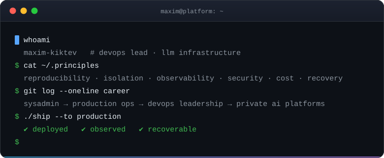
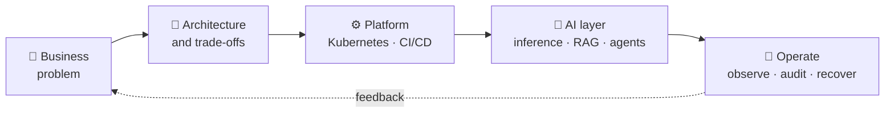
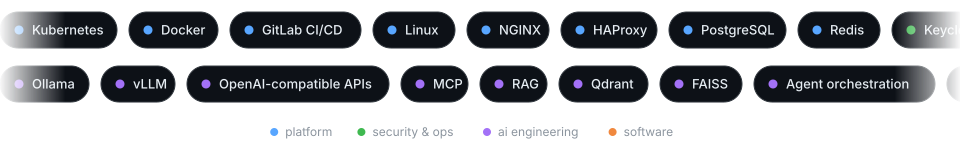

 

**I build reliable platforms where Kubernetes, CI/CD and private LLMs work as one production system.**

<a href="#about"><kbd>&nbsp;👋 About&nbsp;</kbd></a>&nbsp;
<a href="#how-i-work"><kbd>&nbsp;🧭 How I work&nbsp;</kbd></a>&nbsp;
<a href="#what-i-build"><kbd>&nbsp;🏗 What I build&nbsp;</kbd></a>&nbsp;
<a href="#toolbox"><kbd>&nbsp;🧰 Toolbox&nbsp;</kbd></a>&nbsp;
<a href="#contact"><kbd>&nbsp;✉️ Contact&nbsp;</kbd></a>

Click a section to jump — and open the <b>▸ arrows</b> below, they hide a bit more.

## About

I came to AI from systems administration, production operations and DevOps leadership. That shapes how I build: **reproducibility, isolation, observability, security, cost and recovery come before demo magic**.

My focus is the engineering layer between infrastructure and AI — self-hosted inference, RAG, agent runtimes, MCP integrations, code intelligence and delivery automation. I turn these pieces into systems that a team can deploy, operate and trust.

  

## How I work

Every engagement follows the same loop — from a fuzzy business problem to something that runs, is observed and keeps getting better:

Six principles decide almost every design choice:

<table>
<tr>
<td width="33%" valign="top"><b>🔁 Reproducibility</b> If it can't be rebuilt from code, it isn't production.</td>
<td width="33%" valign="top"><b>🧱 Isolation</b> Every agent, task and tenant gets its own boundary.</td>
<td width="33%" valign="top"><b>🔭 Observability</b> You can't operate — or improve — what you can't see.</td>
</tr>
<tr>
<td width="33%" valign="top"><b>🔐 Security</b> SSO, RBAC, secrets and audit are day-one features.</td>
<td width="33%" valign="top"><b>💸 Cost</b> GPU hours and tokens are budgeted like any other resource.</td>
<td width="33%" valign="top"><b>🛟 Recovery</b> A backup only counts once a restore has been rehearsed.</td>
</tr>
</table>

## What I build

<b>🏗&nbsp; Production platforms</b> — environments that stay up and can be rebuilt

 

- Kubernetes and Docker environments
- GitLab CI/CD pipelines and traffic routing
- Monitoring, audit, backup and recovery

<b>🧠&nbsp; Private AI infrastructure</b> — models that run on your hardware, under your rules

 

- Local model serving with OpenAI-compatible endpoints
- GPU capacity planning and long-context workloads
- Air-gapped deployment

<b>🤖&nbsp; Agentic engineering systems</b> — agents with sandboxes, not superpowers

 

- Isolated execution sandboxes
- Tool access and MCP servers
- Repository intelligence and AI-assisted operations

<b>🛡&nbsp; Enterprise foundations</b> — the boring parts that make it adoptable

 

- SSO / RBAC and secrets management
- Traceability and safety controls
- Operable upgrade paths

<b>🧭&nbsp; Technical leadership</b> — from ambiguity to a running service

 

- Architecture and roadmaps
- Hands-on delivery, from an ambiguous business problem to a running production service

## Toolbox

  

<b>Same toolbox, as a plain list</b>

 

| | |
|---|---|
| **Platform & delivery** | Kubernetes · Docker · GitLab CI/CD · Linux · NGINX/HAProxy · PostgreSQL · Redis |
| **AI engineering** | Ollama · vLLM · OpenAI-compatible APIs · MCP · RAG · Qdrant/FAISS · agent orchestration |
| **Security & operations** | Keycloak/SSO · RBAC · secrets management · audit logging · ELK/Logstash · Zabbix · backup/restore |
| **Software engineering** | Go · Python · Bash · TypeScript · React · FastAPI |

## Current focus

- 🧱 Private agent platforms with isolated per-task sandboxes and Docker/Kubernetes delivery.
- ⚡ Reliable local LLM inference for coding, operations and long-running agent workflows.
- 🔍 AI-assisted CI/CD governance, infrastructure diagnostics, code intelligence and technical documentation.

<b>🇷🇺&nbsp; Коротко по-русски</b>

 

Я пришёл в AI из системного администрирования, эксплуатации production-систем и DevOps-лидерства. Поэтому **воспроизводимость, изоляция, наблюдаемость, безопасность, стоимость и восстановление для меня важнее демо-магии**.

Занимаюсь инженерным слоем между инфраструктурой и AI: self-hosted-инференс, RAG, агентные рантаймы, MCP-интеграции, анализ кода и автоматизация поставки. Собираю из этого системы, которые команда может развернуть, эксплуатировать и которым может доверять.

**Что строю:** production-платформы на Kubernetes и Docker · приватную AI-инфраструктуру · агентные системы с изолированными песочницами · enterprise-основу (SSO/RBAC, секреты, аудит) · и руковожу технически — от размытой бизнес-задачи до работающего сервиса.

<b>📦&nbsp; Public repositories — for the curious</b>

 

The work above lives in code too. A few public examples:

| Project | What it demonstrates |
|---|---|
| **[opsmate](https://github.com/Paffin/opsmate)** | A Go CLI/TUI that connects an AI coding agent to live Kubernetes, Docker, Prometheus and infrastructure files through **30 MCP tools** — with explicit safety controls for write operations. |
| **[mcp-superset](https://github.com/Paffin/mcp-superset)** | A production-oriented MCP server exposing **128+ Apache Superset tools**, including dashboards, SQL Lab, users, roles, RLS, permission audits and safeguards for destructive actions. |
| **[Autodocs](https://github.com/Paffin/doc_ai3)** | A fully local code-intelligence and documentation pipeline: Tree-sitter/LSP parsing → semantic graph → structured facts → Ollama-assisted MDX portal, with incremental scans and CI checks. |
| **[RAG Control Center](https://github.com/Paffin/rag-ui)** | An operator-facing local RAG platform built around Ollama and Qdrant, with document ingestion, source-grounded answers, real-time process telemetry, settings and audit history. |
| **[Passwarden](https://github.com/Paffin/passwarden)** | A self-hosted Vaultwarden fork extended with database backups, new-device verification, organization features, tags and real-time webhook delivery. |
| **[Ollama Multi-Agent RAG](https://github.com/Paffin/Ollama-MultiAgent-RAG-OMAR)** | A local multi-agent system combining specialized roles, Ollama, FAISS, document retrieval and tool execution behind a Streamlit control surface. |

## Contact

### Need infrastructure that survives production — and AI that can safely operate inside it?

I am open to architecture reviews, technical leadership and hands-on collaboration on DevOps, private AI and agent-platform projects.

Hand-written SVG animations and native GitHub Markdown — no widgets, no trackers.

